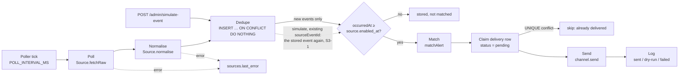

# Design

_System and UI design notes. Written 2026-10-17, before S0. Product decisions are in [assumptions.md](assumptions.md) and technical ones in [decisions.md](decisions.md) (DS1–DS12). This file describes the result; the reasoning stays in those two files._

Scope note (DS3): this is the design only. Shared types are written in S0/S1, and `apps/api/src/db/schema.sql` in S1. Types are plain TypeScript, with no schema library (DS1).

---

## 1. Data model

SQLite via `node:sqlite`. IDs are `TEXT` (UUIDs, except seeded users and fixed source/channel keys). Timestamps are ISO-8601 `TEXT` in UTC. JSON columns are `TEXT`.

| Table | Fields | Keys, indexes, FKs |
|---|---|---|
| `users` | `id`, `name`, `email`, `role` (`'user' \| 'admin'`) | PK `id`. Seeded with 2 users + 1 admin (A8) |
| `channel_connections` | `id`, `user_id`, `type`, `label`, `config` (JSON `Record<string,string>`), `created_at` | PK `id`; FK `user_id → users`; idx `user_id` (A13) |
| `alerts` | `id`, `user_id`, `name`, `source_id`, `keywords` (JSON `string[]`), `min_severity`, `active` (0/1), `created_at`, `updated_at` | PK `id`; FK `user_id → users`, `source_id → sources`; idx `user_id`, idx `(source_id, active)` (A1, A14) |
| `alert_connections` | `alert_id`, `connection_id` | PK `(alert_id, connection_id)`; `alert_id` **ON DELETE CASCADE**; `connection_id` **ON DELETE RESTRICT** (DS4) |
| `sources` | `id` (`'usgs' \| 'bbc'`), `label`, `enabled`, `enabled_at`, `last_poll_at`, `last_error` | PK `id`. `enabled_at` is the baseline (D7) |
| `channel_types` | `type` (`'email' \| 'slack'`), `enabled` | PK `type` (admin toggle, A9) |
| `events` | `id`, `source_id`, `source_event_id`, `title`, `summary`, `url`, `severity`, `occurred_at`, `received_at` | PK `id`; **UNIQUE `(source_id, source_event_id)`** (A7); idx `received_at` |
| `deliveries` | `id`, `kind` (`'alert' \| 'test'`), `user_id`, `alert_id?`, `event_id?`, `connection_id?`, `alert_name?`, `connection_label`, `channel_type`, `status`, `error?`, `preview_id?`, `created_at` | PK `id`; **UNIQUE `(alert_id, event_id, connection_id)`**; `alert_id`, `connection_id` **ON DELETE SET NULL** (DS5); idx `(user_id, created_at)`, idx `created_at` |

Notes
- `Severity = 'low' | 'medium' | 'high'`. `SEVERITIES` in `packages/shared` holds this order and is the only place it is defined.
- `DeliveryStatus = 'pending' | 'sent' | 'dry-run' | 'failed'`.
- Test deliveries (DS8) have `alert_id` and `event_id` set to NULL. SQLite treats NULLs as distinct in UNIQUE, so test sends are never deduped (intended).
- `user_id`, `alert_name`, `connection_label` and `channel_type` on `deliveries` are copies taken at send time, so history survives deletes (DS5).
- `PRAGMA foreign_keys = ON` at connection open (SQLite leaves it off by default).

### Shared types (packages/shared, written in S0/S1)

Entities: `User`, `UserSummary`, `ChannelConnection`, `Alert`, `Event`, `Delivery`, `SourceSummary`, `ChannelTypeSummary`.
Channel metadata: `ChannelField { key, label, type: 'text' | 'email' | 'url', required }`, `ChannelDescriptor { type, label, fields }`, `FieldErrors = Record<string, string>`.
Requests: `ConnectionInput`, `AlertInput`, `AlertActivePatch`, `EnabledPatch`, `SimulateEventInput`.
Responses: `SendResult`, `DeliveryView`, `PollResult`, `ConnectionInUseError`, `ApiError`.
Admin responses (S4, `admin.ts`): `AdminAlertView` (`Alert` + `ownerName`, `connectionLabels`), `AdminDeliveryView` (`DeliveryView` + `userName`), `SourceHealth` (`SourceSummary` + `enabledAt`, `lastPollAt?`, `lastError?`). Names instead of ids, decisions.md S4-2.

---

## 2. Extension points

```ts
// apps/api — one file per source; registered in sources/registry.ts
interface Source {
  id: SourceId;
  label: string;
  fixedSeverity?: Severity;                         // every item gets this severity (S3-3)
  fetchRaw(signal: AbortSignal): Promise<string>;   // I/O only
  normalise(raw: string): NewEvent[];               // pure; severity is set here
}

// apps/api — one file per channel; registered in channels/registry.ts
interface NotificationChannel {
  type: string;
  label: string;
  fields: ChannelField[];                                      // exposed by GET /channels
  validate(config: Record<string, string>): FieldErrors;       // {} = valid
  send(n: Notification, config: Record<string, string>, signal: AbortSignal): Promise<SendResult>;
  // throws (or times out) → delivery 'failed'
}
```

**Adding a channel (e.g. Teams):** write one adapter file that implements `NotificationChannel`, add one line to the channel registry, and add one `channel_types` seed row. `GET /channels` exposes its fields and the web builds the connection form from them. The matcher, poller and dispatcher stay unchanged. The fake-channel component test (S1) backs this up.

**Adding a source:** write one adapter that implements `Source` and add one registry entry plus a `sources` seed row. Source-specific parsing and severity logic stay in the adapter's `normalise` (D1). If `normalise` gives every item the same severity, set `fixedSeverity`: the alert form and the simulate form then lock Severity to it (decisions.md S3-2, S3-3).

The matcher only sees `Event` and `Alert`. The dispatcher looks up `registry.get(connection.type)` and knows no specific channel.

---

## 3. Pipeline



| Step | Input → output | On failure |
|---|---|---|
| Poll | enabled `Source` → raw string. 10s timeout; skipped if a poll is already running for that source | `sources.last_error` is set and the source is skipped this cycle. The poller keeps running. |
| Normalise | raw → `NewEvent[]` | A whole-feed parse error → `last_error`. A single malformed item is skipped, and the rest are kept. |
| Dedupe | `NewEvent[]` → newly inserted `Event[]` | A DB error → `last_error`, and that source's cycle stops. |
| Baseline | new events → events with `occurredAt ≥ sources.enabled_at` (D7) | Pure comparison. Simulated events use `occurredAt = now`, so they pass. |
| Match | `Event` × active alerts on that source → matching alerts. `matchAlert` is pure: same source; keywords empty, **or any** keyword found case-insensitively in title + summary (D8); `severity ≥ min_severity` | No I/O, so nothing can fail here. |
| Claim | for each linked connection whose channel type is enabled → insert a `pending` delivery row | A UNIQUE conflict means it was already delivered, so skip it (never send twice). |
| Send | `channel.send(notification, config)` with a 10s timeout | A throw or timeout → row `failed` with the error. **No retry** (A16). Other sends carry on. |
| Log | `SendResult` → row `sent` or `dry-run`, plus `preview_id` | If the update fails, it is logged to the console. The row stays `pending` and is never re-sent. |

Claiming before sending means a crash can't cause a duplicate send. The cost is that a crash mid-send leaves that row `pending` for good (accepted, no retry).

"Send test" (DS8) skips poll, match and dedupe. It inserts a `kind = 'test'` row, calls `channel.send` and logs the result the same way.

Known limit (DS11): USGS revisions (`properties.updated`) are ignored. Only the first version of a quake is stored and matched.

---

## 4. REST API

All paths are under `/api`. **Public** = mounted before the auth middleware. **User** = needs `X-User-Id` (unknown → 401) and acts only on `req.user`'s data. **Admin** = user + `requireAdmin` (otherwise 403).

| Method | Path | Request → Response | Access | Slice |
|---|---|---|---|---|
| GET | `/health` | → `HealthResponse { status: 'ok', severities }` (S0-6) | public | S0 |
| GET | `/users` | → `UserSummary[]` (`id, name, role`) | public, mock only (DS6) | S1 |
| GET | `/previews/:id` | → HTML email preview (UUID id) | public (DS7) | S1 |
| GET | `/me` | → `User` | user | S1 |
| GET | `/channels` | → `ChannelDescriptor[]` (enabled types only) | user | S1 |
| GET | `/me/connections` | → `ChannelConnection[]` | user | S1 |
| POST | `/me/connections` | `ConnectionInput` → `ChannelConnection` · 400 `FieldErrors` | user | S1 |
| PUT | `/me/connections/:id` | `ConnectionInput` → `ChannelConnection` · 400 `FieldErrors` (also when `type` differs from the stored one: type is immutable, DS12) | user | S1 |
| DELETE | `/me/connections/:id` | → 204 · **409 `ConnectionInUseError { alerts: {id, name}[] }`** (DS4) | user | S1 (409 in S3) |
| POST | `/me/connections/:id/test` | → `SendResult` (and a test delivery row) | user | S1 |
| GET | `/sources` | → `SourceSummary[]` | user | S3 |
| GET | `/me/alerts` | → `Alert[]` | user | S3 |
| POST | `/me/alerts` | `AlertInput` → `Alert` · 400 `fieldErrors.connectionIds` if any ID isn't the user's (DS12) | user | S3 |
| PUT | `/me/alerts/:id` | `AlertInput` → `Alert` · 400 `fieldErrors.connectionIds` if any ID isn't the user's (DS12) | user | S3 |
| PATCH | `/me/alerts/:id` | `AlertActivePatch { active }` → `Alert` | user | S3 |
| DELETE | `/me/alerts/:id` | → 204 | user | S3 |
| GET | `/me/deliveries` | → `DeliveryView[]` (newest first) | user | S3 |
| POST | `/admin/simulate-event` | `SimulateEventInput { sourceId, title, summary?, severity, sourceEventId? }` → `{ event, deliveries }` | admin | S3 |
| POST | `/admin/sources/:id/poll` | → `PollResult` | admin | S2 |
| GET | `/admin/alerts` | → `AdminAlertView[]`: every user's alerts with owner name and connection labels (S4-2) | admin | S4 |
| GET | `/admin/deliveries` | → `AdminDeliveryView[]`: every user's rows with the user name, newest first, test rows included | admin | S4 |
| GET | `/admin/sources` | → `SourceHealth[]` (`enabledAt`, `lastPollAt`, `lastError`) | admin | S4 |
| PATCH | `/admin/sources/:id` | `EnabledPatch` → `SourceHealth`. Turning a disabled source on moves `enabled_at` to now; any other PATCH leaves it (S4-3). 404 unknown id · 400 `fieldErrors.enabled` | admin | S4 |
| GET | `/admin/channels` | → `ChannelTypeSummary[]` (`type, label, enabled`), registered types only | admin | S4 |
| PATCH | `/admin/channels/:type` | `EnabledPatch` → `ChannelTypeSummary` (effects: S1-6). 404 unknown type · 400 `fieldErrors.enabled` | admin | S4 |

Errors: `ApiError { message }`, plus `fieldErrors` on 400. A resource that belongs to another user returns 404, so the API never reveals whether it exists.

IDs in a request body are checked too (DS12). Every `connectionId` in `AlertInput` must belong to `req.user`. An unknown ID and another user's ID get the same 400 `fieldErrors.connectionIds` message, so the response reveals nothing. The check lives in one API helper; `alert_connections` has no `user_id`, so the schema does not enforce it.

---

## 5. Screens

Page components load data and hold state. Display components take inputs and emit outputs only.

| Route | Page | Main components |
|---|---|---|
| (shell) | `AppShell` | toolbar, `<nav>`, `UserSwitcher` (labelled "mock"), admin link only for admins |
| `/connections` | `ConnectionsPage` | `ConnectionList`, `ConnectionFormDialog` → `GeneratedChannelForm` (typed `FormGroup` of string controls from `GET /channels`), `SendTestButton` (pending + result + preview link), 409 "used by these alerts" message |
| `/alerts` | `AlertsPage` | `AlertList` (active toggle with pending/failure state) |
| `/alerts/new`, `/alerts/:id` | `AlertEditPage` | `AlertForm`: name, source select, keyword chips, min severity, connection multi-select, "BBC items are always medium" hint |
| `/history` | `HistoryPage` | `DeliveryTable` (time, alert or "Test", event + severity, connection · type, status + error, preview link), Refresh |
| `/admin` (`adminGuard` as `canMatch`: hides only, sends non-admins to `/alerts`; the shell also leaves `/admin` when the user switches to a non-admin) | `AdminPage` with tabs; each tab is a small container that loads its data on first open (S4-5) | Delivery log → `DeliveryTable` (reused, with a User column); Sources → `SourceHealthTable` (enable switch, poll now); Channels → `ChannelTypesTable` (enable switch); All alerts → `AdminAlertsTable`; Simulate event → `SimulateEventForm` (severity locked for a `fixedSeverity` source, S4-4) |

Every data view handles loading, empty and error states. Routes are lazy-loaded. The layout works down to 375px.

---

## 6. Data sources

Both feeds were fetched on 2026-10-17. **VERIFIED** = the field was seen in that live response.

### USGS: `https://earthquake.usgs.gov/earthquakes/feed/v1.0/summary/2.5_day.geojson`
HTTP 200, `application/json`, 48 features.

| `Event` field | Mapped from | Status |
|---|---|---|
| `sourceEventId` | `feature.id` (e.g. `us6000u30x`) | VERIFIED |
| `title` | `properties.title` (`"M 4.6 - 88 km SSW of Uyuni, Bolivia"`) | VERIFIED |
| `summary` | built from `properties.place`, `properties.mag`, depth `geometry.coordinates[2]` (km) | VERIFIED (all three present) |
| `url` | `properties.url` | VERIFIED |
| `occurredAt` | `properties.time` (epoch ms → ISO) | VERIFIED |
| `severity` | `properties.mag`: `< 4.5` low, `< 6` medium, `≥ 6` high (DS10) | VERIFIED (all 48 non-null). A null `mag` is possible according to USGS → the item is skipped. That null case is UNVERIFIED in the live data |

### BBC World: `https://feeds.bbci.co.uk/news/world/rss.xml`
HTTP 200, `text/xml`, RSS 2.0, 23 items.

| `Event` field | Mapped from | Status |
|---|---|---|
| `sourceEventId` | `<guid isPermaLink="false">` without its `#n` suffix (DS9, revised 2026-10-18) | VERIFIED: the suffix changes when a story is updated (F6, testing.md S2-12: 3 of 22 articles went `#0` → `#1`), so it is dropped and an updated story is not sent again |
| `title` | `<title>` (CDATA) | VERIFIED |
| `summary` | `<description>` (CDATA) | VERIFIED |
| `url` | `<link>` (includes `at_medium`/`at_campaign` tracking params) | VERIFIED |
| `occurredAt` | `<pubDate>` (RFC 822 → ISO) | VERIFIED |
| `severity` | fixed `medium`, set in `normalise` only (D1) | n/a |

Attribution: notifications name the source (A25). The BBC feed's `<copyright>` points to the BBC terms of use for RSS reuse.

---

## 7. Known limits and open points

- ~~**F6:** BBC guid stability (DS9).~~ Closed 2026-10-18: the suffix changes, so the BBC adapter drops it (DS9 revised). Like DS11, an updated story does not re-alert.
- **DS11:** USGS magnitude revisions don't re-alert.
- **DS6, DS7:** `GET /users` and the preview links are public. Mock-level only.
- A crash mid-send leaves a delivery `pending` for good (no retry, A16).
- Still open in plan-v2: **F1** (A3 wording), **F2** (region filter), **F3** (A14 "threshold" wording). None of them affects this design.
- Budget: DS4 and DS8 each add ~0.15h, taken from the 0.45h buffer, which leaves ~0.15h.
